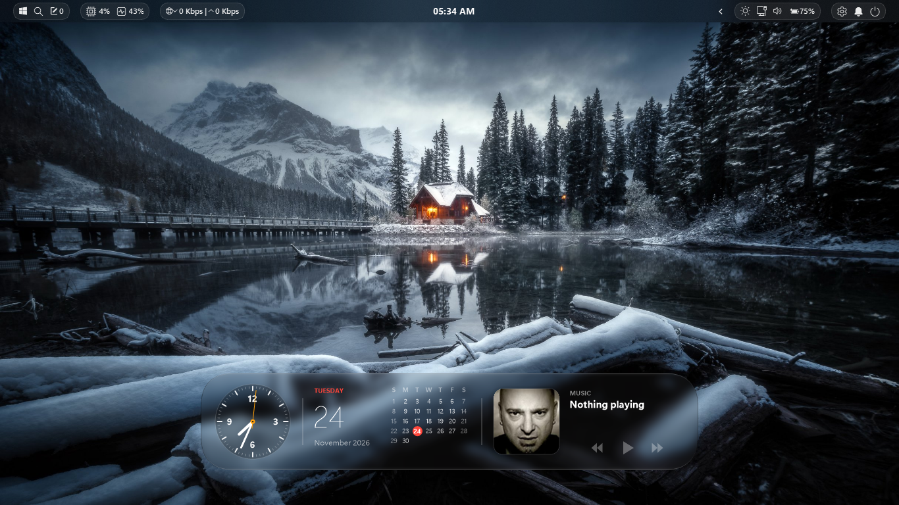

# StarBar-A-YASB-Reborn-Theme-
Minimal status bar with classic yet modern look.
A pill-style status bar config for YASB (Yet Another Status Bar) on Windows 10/11.

What's in the bar

Widgets are grouped into "pills":

Pill	Widgets
Launcher	Home menu, Quick launch, Notes
System	CPU, Memory (right-click opens RAMMap, see below)
Network	Traffic
Status	Brightness, Wi-Fi, Volume, Battery
Actions	Control center, Notifications, Power menu

Also included: clock with calendar, system tray, and a show-desktop button.

Requirements
YASB, installed and working.
Fonts, install these or icons and text will look broken:
JetBrainsMono Nerd Font Propo (JetBrainsMono NFP) from nerdfonts.com
Segoe Fluent Icons (built into Windows 11; Windows 10 users can download it from Microsoft)
Segoe UI Variable (built into Windows 11; falls back to Segoe UI on Windows 10)
Installation
Close YASB (right-click the tray icon, then Exit).
Back up your current config folder if you have one: C:\Users\<you>\.config\yasb\
Copy config.yaml, styles.css and yasb_colors.css into that folder.
Start YASB again.
Customizing
Timezone: the clock uses your system timezone. To pin a specific one, edit timezones under clock in config.yaml, e.g. timezones: [Asia/Karachi].
Colors: yasb_colors.css is auto-generated from your Windows accent color. Override the variables in styles.css if you want fixed colors.
Quick-launch / Home folders: edit the path entries under home in config.yaml.
RAMMap shortcut: the memory widget's right-click runs C:\Tools\RAMMap64.exe. Install RAMMap there, or change/remove the on_right callback.
Desktop PC (no battery): you may see KeyError: 'percent' in yasb.log. It's harmless, but you can remove battery from the status pill to silence it.
Troubleshooting
Check C:\Users\<you>\.config\yasb\yasb.log for errors. If the bar doesn't load, it's usually a YAML indentation problem in config.yaml.
Wi-Fi widget shows "Access is denied": allow location access in Windows Settings > Privacy & security > Location.
License

Free to use and modify. Credit is appreciated.
